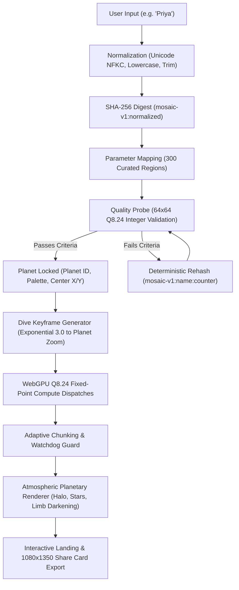

# Mandelbrot Mosaic

<div align="center">

[](https://w3c.github.io/webgpu/)
[-success?style=for-the-badge)](REFERENCE-HASHES.md)
[](test/)
[](#zero-backend-architecture)
[](LICENSE)

<br/>

### **[Explore Live: mosaic-neon.vercel.app](https://mosaic-neon.vercel.app/)**

*Type any name. The browser derives an exact planetary coordinate in the Mandelbrot set and falls into it.*

</div>

---

## 🌌 Overview

**Mandelbrot Mosaic** is a deterministic procedural celestial dive engine built on client-side **WebGPU compute shaders**. 

Visitors enter a name, word, or phrase in any language (Latin, Devanagari, Arabic, CJK, etc.). The engine maps that identity to an exact coordinate in a curated 300-region Mandelbrot catalogue, evaluates millions of fractal iterations using bit-identical **Q8.24 fixed-point integer arithmetic**, and animates a seamless, multi-resolution zoom into the newly discovered planet.

- **Zero Server Compute:** No backend renders tiles or processes images. Everything is computed live on the visitor's GPU.
- **Zero Database:** Every planet is mathematically derived from its name. Share URLs (`?n=Priya`) reproduce the exact same planet on any machine.
- **Zero Third-Party Trackers or Fonts:** No external network requests; native system typography and inline SVG favicon.

---

## 🏛️ Architecture & Pipeline



---

## ⚙️ Core Engineering Pillars

### 1. Deterministic Q8.24 Fixed-Point Engine
Standard 32-bit floating-point (`f32`) math is non-associative: $(a + b) + c \neq a + (b + c)$. Fused Multiply-Add (FMA) instructions, GPU compiler optimization flags, and driver variance cause standard GPU fractal renders to produce subtly different pixels across AMD, NVIDIA, Intel, and Apple GPUs.

In Mandelbrot Mosaic, all coordinates and iteration steps are executed using **signed 32-bit integer arithmetic in Q8.24 fixed-point representation**:
- Scale factor: $1.0 = 2^{24} = 16,777,216$
- Intermediate multiplication: 64-bit integer product with symmetric truncation toward zero: `(a * b) / 2^24`
- Guaranteed identical bit-level iteration outputs across all WebGPU platforms.

### 2. Adaptive Chunking & Watchdog Defense
Deep fractal tiles near boundaries can take tens of millions of iterations. To prevent browser GPU watchdog timeouts (TDR on Windows, Metal device aborts on macOS), dispatches are automatically profiled:
- **Workload Estimation:** A 32×32 CPU/GPU calibration probe estimates iteration weight.
- **Sub-Block Decomposition:** Tiles with heavy estimated compute (e.g. `maxIter = 20,000`) are partitioned into sub-blocks ($128\times 128$ or $64\times 64$) interleaved across animation frames, yielding smooth frame rates without device crashes.

### 3. Procedural Atmospheric Synthesis
Each planet is rendered on-the-fly inside an HTML5 canvas:
- **Limb Darkening & Spherification:** Radial inverse cosine mapping giving the flat 2D tile 3D spherical depth.
- **Rayleigh Scattering Halo:** Multi-layered gaussian atmospheric glow based on the planet's atmospheric palette.
- **Procedural Starfield:** Hash-seeded background stars with realistic magnitude distributions.

### 4. Interactive Synthesized Audio
Audio is generated dynamically using the browser's native **WebAudio API**:
- Continuous dual-oscillator drone with subtle harmonic overtone detuning.
- Pitch bends downwards as the camera dives into the Mandelbrot depth.
- Zero audio asset downloads (0 KB bandwidth overhead).

---

## 🏷️ Engine v1 Reference Hashes

The planetary engine is frozen at `ENGINE_VERSION = 1`. Any modification to the engine logic without explicitly changing the version fails the automated test suite.

| Reference Name | Planet ID | Rehash Counter | Palette Name | Final 512 Keyframe Hash |
| :--- | :--- | :--- | :--- | :--- |
| **Priya** | `81357026` | 0 | Ice | `0x9a90facd` |
| **Rahul** | `184b2ca5` | 0 | Deep Sea | `0x1c470754` |
| **Aman** | `e57d2897` | 3 | Aurora | `0x7d0ece54` |
| **Neha** | `ed0aa39e` | 0 | Aurora | `0x48050231` |
| **Kuber** | `81e905b5` | 1 | Ice | `0x3fca3290` |

### Frozen Canonical Hashes
- **Region Catalogue SHA-256:** `793adc48b7b93dc7226395233d2fc7a2140afa331cfcb07f705db9dec22d8238`
- **Tile B2 (42, 16):** `0x985dade1`
- **Tile C2 (49, 41):** `0x329ac730`
- **Tile D2 (49, 22):** `0xa63eed4d`
- **Heavy Tile (20,000 maxIter):** `0x8a1e2fc9`

---

## 🎨 Palettes

Planet atmosphere color schemes are derived from the SHA-256 hash:

1. **Deep Sea (Index 0):** Abyssal cyan, oceanic teal, bioluminescent depths.
2. **Ember (Index 1):** Volcanic crimson, molten gold, solar flares.
3. **Aurora (Index 2):** Emerald nebula, polar violet, high-latitude ionosphere.
4. **Ice (Index 3):** Glacial cerulean, crystalline white, nitrogen frost.

---

## 📁 Repository Structure

```
├── index.html                 # Production entrypoint & UI layout
├── vite.config.ts             # Vite configuration with build-time URL transforms
├── src/
│   ├── config.ts              # Global constants (SITE_URL, ENGINE_VERSION, CONFIG)
│   ├── cpuFixed.ts            # BigInt reference Q8.24 implementation
│   ├── dive.ts                # Exponential zoom keyframe trajectory planner
│   ├── divePage.ts            # UI orchestrator, live preview, ambient world & audio
│   ├── fnv.ts                 # Bit-identical FNV-1a 32-bit hashing utilities
│   ├── gpuTileFixed.ts        # WebGPU fixed-point compute pipeline & dispatch manager
│   ├── nameEngine.ts          # Unicode normalization, hashing, and candidate mapping
│   ├── palette.ts             # Curated color ramps and gradient evaluation
│   ├── regions.json           # 300 curated Mandelbrot coordinates (SHA-256 frozen)
│   ├── renderer.ts            # Spherical planetary atmosphere & canvas compositing
│   └── shaderFixed.wgsl.ts    # WebGPU WGSL compute shader source
├── test/
│   ├── engineVersion.test.ts  # Verification suite locking reference planets & hashes
│   ├── nameEngine.test.ts     # Normalization & candidate mapping tests
│   ├── cpuFixed.test.ts       # Q8.24 BigInt mathematical verification
│   ├── dive.test.ts           # Zoom path coordinate integrity tests
│   └── ...                    # 48 tests in total
└── scripts/
    ├── audit-network.mjs      # Playwright network audit confirming 0 external requests
    ├── audit-overlaps.mjs     # Multi-viewport UI bounding-box overlap audit
    └── compute-reference-hashes.mjs # Reference table computation tool
```

---

## 🚀 Getting Started

### Prerequisites
- [Node.js](https://nodejs.org/) v18 or newer
- Modern browser with WebGPU support (Chrome 113+, Edge 113+, Safari 26+)

### Installation
```bash
git clone https://github.com/agarwalpranav0711/mosaic.git
cd mosaic
npm install
```

### Development Server
```bash
npm run dev
```
Open [http://localhost:5173/](http://localhost:5173/) to enter the Mandelbrot dive.

### Run Verification Test Suite
```bash
# Runs 48 unit tests in Node (verifies Q8.24 arithmetic, engine version, and hashes)
npm test

# Production build verification
npm run build
```

---

## 🛡️ Privacy & Performance

- **Zero Tracking:** No Google Analytics, telemetry, or external tracking pixels.
- **Zero External Host Connections:** `index.html` loads 0 third-party stylesheets or scripts. All typography uses high-performance system font stacks.
- **Inline Assets:** Favicon is an inline SVG data URI; no external favicon request is made.

---

## 📄 License

Distributed under the MIT License. See [LICENSE](LICENSE) for full details.
